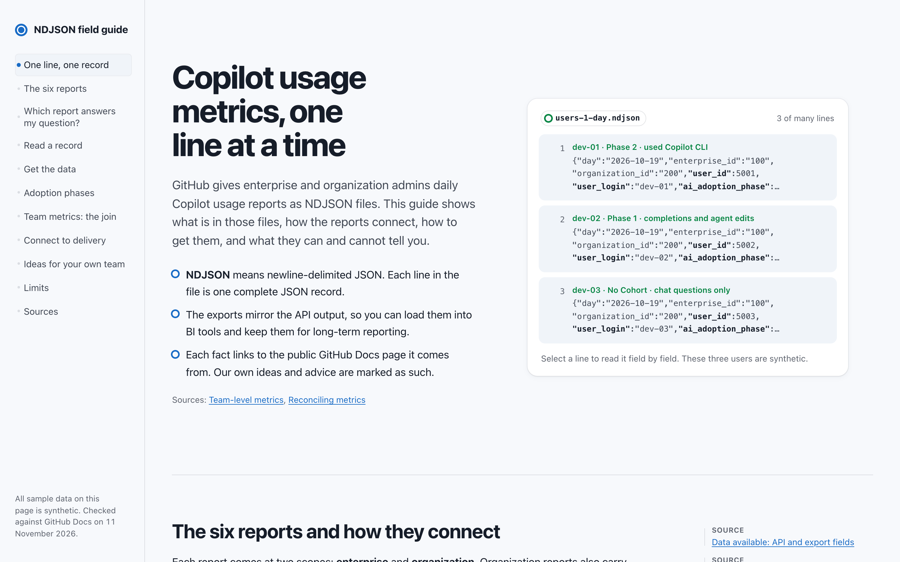

# Copilot usage metrics: NDJSON field guide

A one-page, interactive guide to the GitHub Copilot usage metrics reports that
admins can export as NDJSON files. It explains:

- which reports exist and how they connect,
- what the key fields mean, with a sample record you can read field by field,
- how to get the data from the dashboard or the REST API, and who can get it,
- how to use it: adoption phases, team metrics, and links to delivery data,
- the limits you must know before you present any numbers.

## View it online

Open <https://solid-robot-vo3n62m.pages.github.io/>. This site is visible to
members of this organization only. GitHub asks you to sign in first.

## How to open it

The page needs no install, no build, and no internet connection.

1. Download or clone this repository.
2. Open `index.html` in a web browser.

You can also serve the folder locally, for example with
`python3 -m http.server`, and open the address it prints.

## About the content

- **All sample data is synthetic.** Usernames such as `dev-01` and IDs such as
  `5001` are invented. The field names and shapes follow the public
  [example schema](https://docs.github.com/en/enterprise-cloud@latest/copilot/reference/copilot-usage-metrics/example-schema).
- **Each fact cites public GitHub Docs.** Ideas and advice that do not come
  from the docs are marked as such on the page.
- **Verify against the docs.** The content was checked against GitHub Docs on
  11 November 2026. The docs change often. Check the linked source before you
  rely on a detail.

## Not an official GitHub product

This is an unofficial community learning aid. It is not a supported GitHub
product, and it is not GitHub documentation. For the authoritative reference,
see
[Data available in Copilot usage metrics](https://docs.github.com/en/enterprise-cloud@latest/copilot/reference/copilot-usage-metrics/copilot-usage-metrics).

## Files

| File | What it holds |
| --- | --- |
| `index.html` | The page structure and text |
| `styles.css` | The visual design |
| `app.js` | The interactive parts: report map, question finder, record reader, team join steps |
| `data.js` | Synthetic sample records and the field notes, each with its docs link |
| `screenshots/` | Images of the page at laptop width |
| `PRODUCT.md`, `DESIGN.md` | Notes on the audience and the design system |
